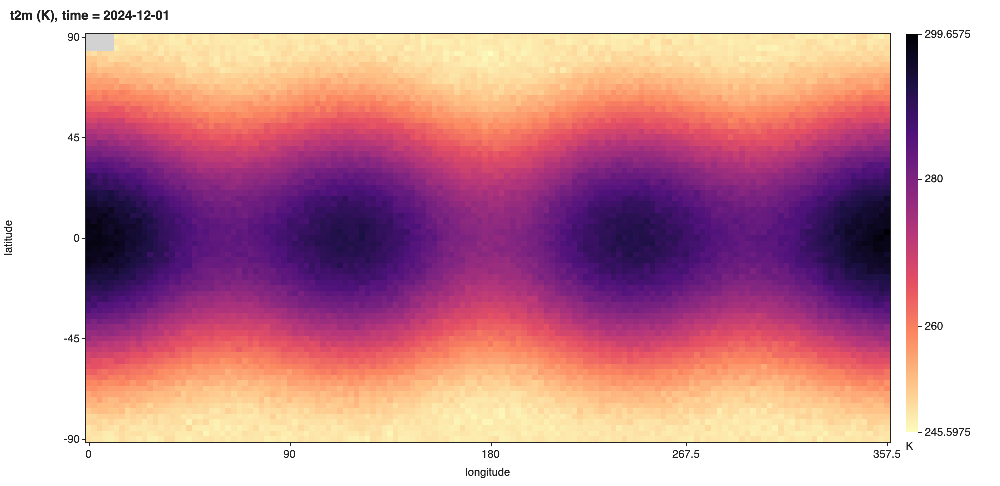

# NetCDF Viewer & HDF5 Viewer (NC, H5)

A NetCDF viewer and HDF5 viewer for climate and lab scientists who keep data in `.nc` or `.h5` files. It shows the variables, their CF metadata, the values and a plot inside VS Code, without a line of Python.

Version 0.3.0 adds plot controls: pick a colour map and colour range for the heatmap, click a grid point to plot its time series, and save any plot as a PNG.

*A real VS Code window (version 0.3.0 installed from its VSIX) running this extension on [`samples/era5-t2m-sample.nc`](samples/era5-t2m-sample.nc), a 1.3 MB NetCDF-4 file made by `scripts/make-samples.py`.*

*The file "Save PNG" wrote, unchanged.*

  

- Made for NetCDF and climate data. Dimension names, coordinates, `scale_factor`, `add_offset`, `_FillValue` and CF time units are applied for you, so you see 263.75 K on 2024-12-04 06:00, not `1500` at index 13. The noleap, 360_day and all_leap calendars work too.
- Big files stay fast. The file is read slice by slice in a background thread. In our test a 37 GB array opens, shows a page and draws a sampled heatmap in about one second, and a slow read is stopped after 20 s instead of freezing the editor.
- Plots you can use in a report. Choose from 8 colour maps (viridis, cividis, magma, inferno, plasma, turbo, gray and a diverging blue-red map), reverse them, set the range (2-98 percentile, min to max, symmetric around 0, from the `valid_range` or `actual_range` attribute, or your own numbers) and turn on a log scale. "Save PNG" writes the plot with its title, units, the slider positions and the colour bar.
- Click a point, get its time series. On a variable with 3 or more dimensions, a click on the heatmap plots that grid point along time (or another dimension you pick), with dates on the x axis, like ncview does. Save it as PNG or copy it as CSV.
- One viewer for HDF5, NetCDF-4 and NetCDF-3, including HDF5 files with other names such as Julia `.jld2`, MATLAB 7.3 `.mat` and `.loom`. Groups, attributes, compound tables, strings, chunking and compression filters are all shown. Nothing leaves your machine.

## Quick start

1. Install the extension.
2. Click a `.nc` or `.h5` file in the Explorer. Pick a variable on the left.

*Recorded in the same window. The white arrow is drawn in to show where each click lands.*

## What you can do

- Browse the group tree with a filter box. Coordinates, plain datasets, external links and NetCDF dimensions have their own icons.
- Read the file overview (format, dimensions, global attributes and a table of all variables with units and long names), much like `ncdump -h`.
- See type, shape with dimension names, chunk shape, compression (shuffle, deflate level, LZF, szip and others by name), size in memory and the full attribute list. Internal HDF5 and NetCDF attributes are hidden behind a checkbox.
- Pick any two dimensions as rows and columns. Sliders fix the others and show the decoded coordinate value next to the index.
- Page through values 100 rows by 30 columns at a time, with coordinate values as row and column headers.
- Plot 1D data as a line and 2D slices as a heatmap with a colour bar and hover readout. Arrays larger than 512 x 512 are sampled with a stride.
- Pick a colour map, reverse it, choose the colour range and a log scale. The colour map default is the setting `hdf5NetcdfExplorer.colormap`.
- Click a heatmap cell to plot the values at that point along time or another dimension. Escape closes the series.
- Save a heatmap, line plot or series as PNG with "Save PNG". The picture has a title with the variable, units and the slider positions, axis labels and the colour bar.
- See min, max, mean, std and the number of fill, NaN and Inf values for the slice on screen.
- Copy the path, or copy xarray or h5py code that loads the same slice.
- Export the slice on screen to CSV or JSON with "Export slice…". You get every row and column of the two chosen dimensions, with the coordinate values as headers. The sliders fix the other dimensions, and the JSON file records which index and value each of them had. Text from the file that starts with `=`, `+`, `-` or `@` gets a leading `'` in the CSV, so a spreadsheet does not run it as a formula.
- Turn CF decoding off to see the raw stored numbers.
- The view reloads when the file changes on disk, which helps while a model run is writing output. A script that deletes the file and writes it again also triggers a reload.

## Supported files

| Format | How it is read |
|---|---|
| NetCDF-4 and NetCDF-4 classic (`.nc`, `.nc4`) | h5wasm (HDF5 2.0 compiled to WebAssembly) |
| HDF5 (`.h5`, `.hdf5`, `.he5`, `.hdf`, `.nxs`, `.h5ad`) | h5wasm |
| HDF5-based formats (`.jld2`, `.loom`, `.h5mu`, `.hf5`, `.h5oina`, `.h5ebsd`, `.edaxh5`, `.oh5`, `.dream3d`, `.geoh5`, `.nde`, `.cxi`) | h5wasm, the same way as `.h5` |
| MATLAB 7.3 (`.mat`), or an HDF5 file with any other name | h5wasm. Right-click the file and pick "Open in HDF5 NetCDF Explorer", or use "Reopen Editor With…" |
| NetCDF-3 classic and 64-bit offset (`.nc`, `.cdf`) | netcdfjs parses the header, values are read by byte offset |

The format is detected from the first bytes of the file, not from the extension, so a 512-byte user block (JLD2 and MATLAB 7.3 files have one) is fine. HDF4, NASA CDF, NetCDF CDF-5 and older MATLAB v5 `.mat` files get a clear message instead of an error.

## Settings

| Setting | Default | Meaning |
|---|---|---|
| `hdf5NetcdfExplorer.maxReadValues` | 1000000 | Largest number of values one read may return |
| `hdf5NetcdfExplorer.maxFileSizeMB` | 0 | Refuse files above this size, 0 means no limit |
| `hdf5NetcdfExplorer.readTimeoutSeconds` | 20 | Stop a read that takes longer and restart the reader |
| `hdf5NetcdfExplorer.colormap` | viridis | Colour map a heatmap starts with: viridis, cividis, magma, inferno, plasma, turbo, gray or coolwarm |
| `hdf5NetcdfExplorer.askForRating` | true | Ask one time for a Marketplace rating, after 5 files and 2 days. Turn it off with `false` |

## Privacy and safety

The extension makes no network calls and has no telemetry. It never runs code from a file. Values go to the view as plain JSON and are drawn as text or canvas pixels, under a strict Content Security Policy with no remote scripts.

## Known limits

- Files must be on this computer. Remote and virtual file systems are not supported yet.
- HDF5 filters that are not built into h5wasm (Blosc, Zstd, bitshuffle and other plugins) show the filter name and a read error.
- Zarr is not supported yet.
- MATLAB `.mat` files saved in the v5 format are not HDF5. Save them again with `save(filename, '-v7.3')`.
- Export writes at most `hdf5NetcdfExplorer.maxReadValues` values (1,000,000 by default) per file.
- The colour maps other than viridis are blended from 2 to 15 anchor colours, so they are close to the matplotlib maps but not identical.
- The colour range and saved heatmap PNG use the cells on screen, which are sampled to at most 512 x 512 for big arrays. Saved pictures are dark text on white, whatever the editor theme.
- A point series needs a numeric variable with 3 or more dimensions. Above 100,000 points it takes every Nth value and says so.
- The standard calendar uses the proleptic Gregorian calendar for dates before 1582.

## Credits

HDF5 reading uses [h5wasm](https://github.com/usnistgov/h5wasm) by the National Institute of Standards and Technology, which bundles the HDF5 library by The HDF Group. NetCDF-3 headers are parsed with [netcdfjs](https://github.com/cheminfo/netcdfjs) (MIT). See `THIRD-PARTY-NOTICES.txt`.

## License

MIT

## Support Zovo

Zovo extensions are free, with no ads and no tracking. They are made by [theluckystrike](https://github.com/theluckystrike) on GitHub. If this one saves you time, you can support the work:

- [Sponsor on GitHub](https://github.com/sponsors/theluckystrike)
- [Follow theluckystrike on GitHub](https://github.com/theluckystrike)

## More tools by Zovo

- [GGUF, Safetensors & NPY Viewer (NumPy Viewer)](https://marketplace.visualstudio.com/items?itemName=zovo.tensor-viewer) shows NPY, NPZ, Safetensors and GGUF tensors with stats and heatmaps.
- [PKL Viewer & Pickle Viewer](https://marketplace.visualstudio.com/items?itemName=zovo.zovo-pickle-viewer) opens Python pickle files without Python and never runs their code.
- [TIFF Viewer (16-bit, Float, GeoTIFF)](https://marketplace.visualstudio.com/items?itemName=zovo.tiff-viewer) opens 16-bit, float, multi-page and GeoTIFF images.
- [CSV Viewer, Excel Viewer (XLSX) & Parquet Viewer](https://marketplace.visualstudio.com/items?itemName=zovo.table-viewer-vscode) opens CSV, TSV, Excel and Parquet files as a sortable, filterable table.
- [Large JSON Viewer & JSON Tree](https://marketplace.visualstudio.com/items?itemName=zovo.zovo-json-tree-viewer) shows large JSON files as a searchable tree, copies JSONPath and turns arrays of objects into a table.

See [all Zovo extensions on the Marketplace](https://marketplace.visualstudio.com/publishers/zovo).
