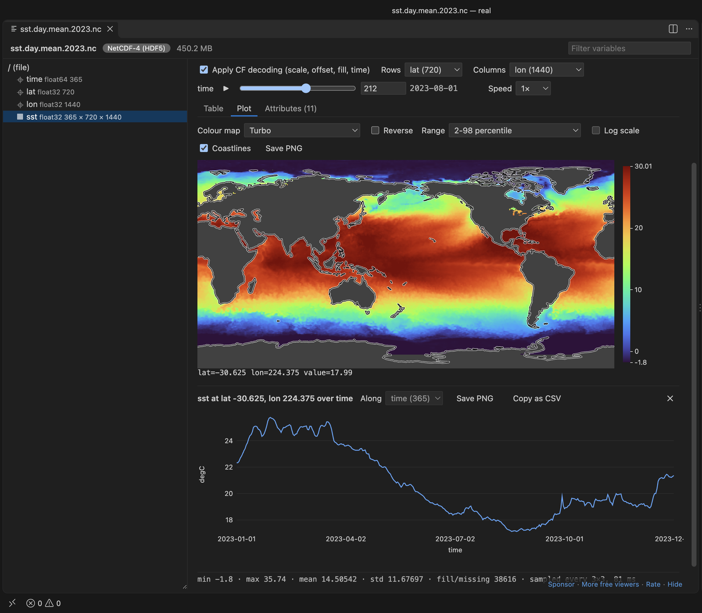
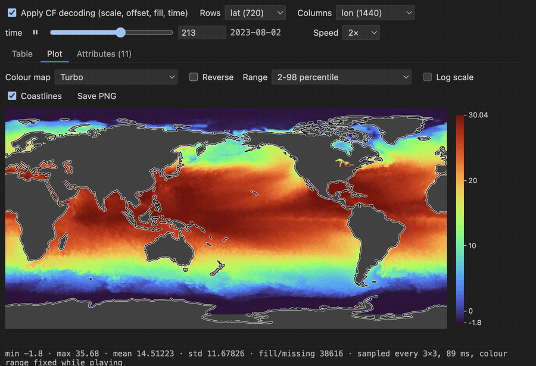
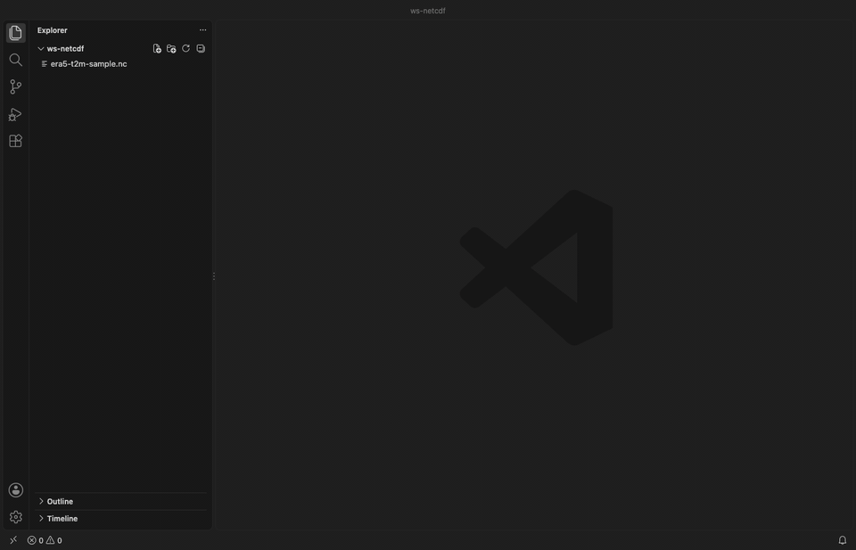
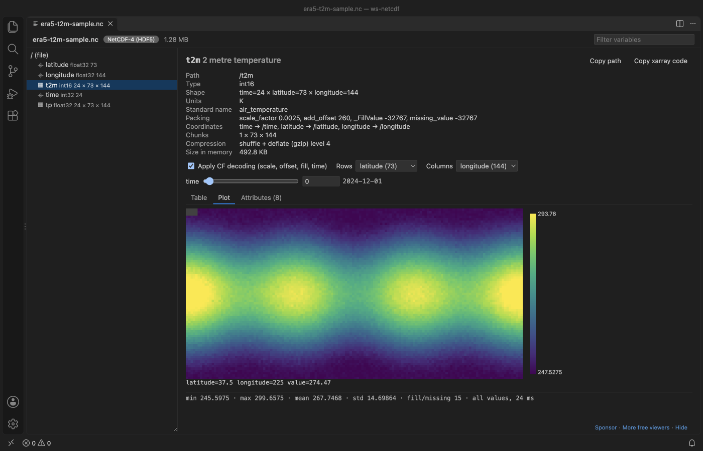
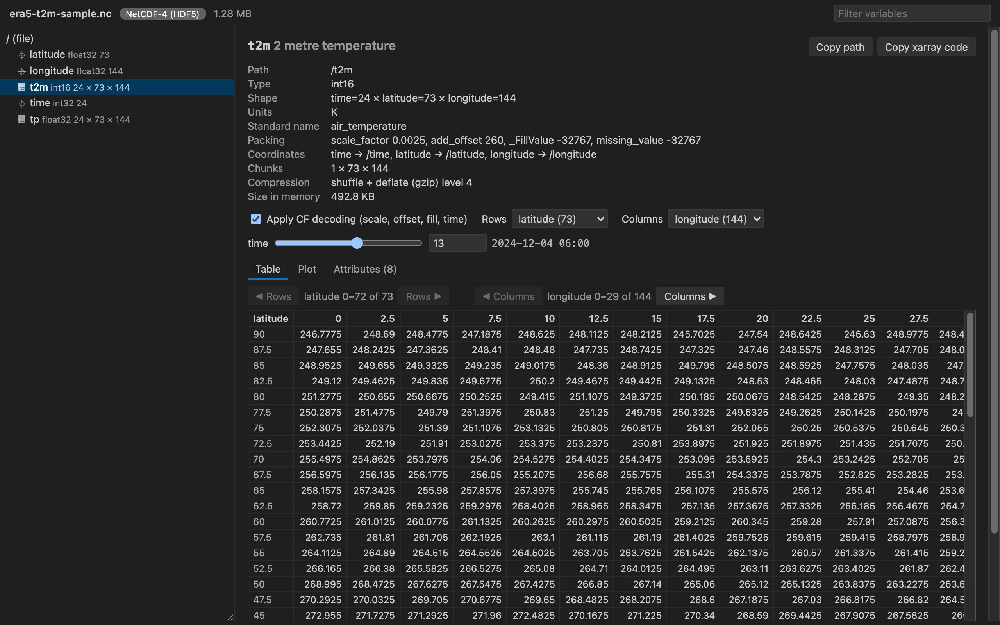

# NetCDF Viewer & HDF5 Viewer (NC Viewer, H5 Viewer, MATLAB MAT Viewer)

A NetCDF viewer, HDF5 viewer and MATLAB MAT viewer for climate and lab scientists who keep data in `.nc`, `.h5` or `.mat` files. It shows the variables, their metadata, the values and a map inside VS Code. No Python, no MATLAB, no NCL, nothing to set up.

MATLAB `.mat` files open with a click: v7.3 and the default v7 format (v5 layout, compressed or not), plus v4. You need no MATLAB and no Python. Structs and cells show as a tree, and matrices show as rows x columns, the way MATLAB prints them.

New in 0.5.0:

- MATLAB `.mat` viewer. Every numeric class (double, single, int8 to uint64, logical), char arrays as text, complex arrays, sparse matrices (the non-zeros as a row, column, value table, and the full matrix for any slice), cells, structs, struct arrays and objects. Uncompressed variables are read slice by slice; compressed ones are unpacked up to 256 MB each.
- Complex numbers. A "Complex" menu shows a + bi, the magnitude, the phase, or the real or imaginary part, in the table, the heatmap, the line plot and the point series. It works for MATLAB complex arrays, h5py `complex64`/`complex128` (HDF5 compound `{r, i}`), NetCDF-4 compound complex types and MATLAB v7.3 `{real, imag}`.

*A real VS Code window running version 0.4.0 on `sst.day.mean.2023.nc` from NOAA PSL (OISST v2 high resolution, daily, 2023). The map is sampled to every 3rd latitude and longitude, so it keeps its 2:1 shape, and drew in about 0.1 s. A click on the map plotted that point over 365 days.*

*Play (▶ next to the time slider) on the same 450 MB file, recorded frame by frame in VS Code.*

  

- Maps with coastlines. When a heatmap's rows and columns are latitude and longitude, it draws the Natural Earth coastlines and puts north at the top. Grids from 0 to 360 and from -180 to 180 both work, and so do regional grids.
- Play through time. The ▶ button next to a slider steps through time, or any other dimension, at the speed you pick. The colour range stays fixed while it plays, so you can compare the frames.
- Made for NetCDF and climate data. Dimension names, coordinates, `scale_factor`, `add_offset`, `_FillValue` and CF time units are applied for you, so you see 263.75 K on 2024-12-04 06:00, not `1500` at index 13. The noleap, 360_day and all_leap calendars work too.
- Big files stay fast. The file is read slice by slice in a background thread. In our test a 37 GB array opens, shows a page and draws a sampled heatmap in about one second, and a slow read is stopped after 20 s instead of freezing the editor.
- Plots you can use in a report. Choose from 8 colour maps (viridis, cividis, magma, inferno, plasma, turbo, gray and a diverging blue-red map), reverse them, set the range (2-98 percentile, min to max, symmetric around 0, from the `valid_range` or `actual_range` attribute, or your own numbers) and turn on a log scale. "Save PNG" writes the plot with its title, units, the slider positions and the colour bar.
- Click a point, get its time series. On a variable with 3 or more dimensions, a click on the heatmap plots that grid point along time (or another dimension you pick), with dates on the x axis, like ncview does. Save it as PNG or copy it as CSV.
- Remote SSH, WSL and dev containers: VS Code runs this extension on the machine that has the file, so a 40 GB file stays where it is and only the slice on screen is sent to your window.
- One viewer for HDF5, NetCDF-4, NetCDF-3 (classic, 64-bit offset and CDF-5) and MATLAB `.mat` (v4, v5, v7 and v7.3), including HDF5 files with other names such as Julia `.jld2` and `.loom`. Groups, attributes, compound tables, strings, chunking and compression filters are all shown. Nothing leaves your machine.

## Quick start

1. Install the extension.
2. Click a `.nc` or `.h5` file in the Explorer. Pick a variable on the left.

*Recorded in the same window. The white arrow is drawn in to show where each click lands.*

## What you can do

- Browse the group tree with a filter box. Coordinates, plain datasets, external links and NetCDF dimensions have their own icons.
- Read the file overview (format, dimensions, global attributes and a table of all variables with units and long names), much like `ncdump -h`.
- See type, shape with dimension names, chunk shape, compression (shuffle, deflate level, LZF, szip and others by name), size in memory and the full attribute list. Internal HDF5 and NetCDF attributes are hidden behind a checkbox.
- Pick any two dimensions as rows and columns. Sliders fix the others and show the decoded coordinate value next to the index.
- Page through values 100 rows by 30 columns at a time, with coordinate values as row and column headers.
- Plot 1D data as a line and 2D slices as a heatmap with a colour bar and hover readout. Arrays larger than 512 x 512 are sampled with a stride.
- Read HDF5 files compressed with LZF, Blosc, bitshuffle, Zstd, LZ4, bzip2 or ZFP, as h5py, hdf5plugin and detector software write them, with no Python.
- See 8-bit RGB and RGBA images (height x width x 3 or 4, or HDF5 `CLASS=IMAGE`) as colour pictures, with the channel values under the mouse.
- Turn the coastlines on or off on latitude-longitude maps. They are drawn in the saved PNG too.
- Press ▶ next to any slider to play through that dimension. Pick the speed (0.5×, 1×, 2× or as fast as the file reads). Escape, a slider move or another variable stops it.
- Pick a colour map, reverse it, choose the colour range and a log scale. The colour map default is the setting `hdf5NetcdfExplorer.colormap`.
- Click a heatmap cell to plot the values at that point along time or another dimension. Escape closes the series.
- Save a heatmap, line plot or series as PNG with "Save PNG". The picture has a title with the variable, units and the slider positions, axis labels and the colour bar.
- See min, max, mean, std and the number of fill, NaN and Inf values for the slice on screen.
- Copy the path, or copy xarray, h5py or SciPy (`loadmat`) code that loads the same data.
- Export the slice on screen to CSV or JSON with "Export slice…". You get every row and column of the two chosen dimensions, with the coordinate values as headers. The sliders fix the other dimensions, and the JSON file records which index and value each of them had. Text from the file that starts with `=`, `+`, `-` or `@` gets a leading `'` in the CSV, so a spreadsheet does not run it as a formula.
- Turn CF decoding off to see the raw stored numbers.
- The view reloads when the file changes on disk, which helps while a model run is writing output. A script that deletes the file and writes it again also triggers a reload.

## Supported files

| Format | How it is read |
|---|---|
| NetCDF-4 and NetCDF-4 classic (`.nc`, `.nc4`) | h5wasm (HDF5 2.0 compiled to WebAssembly) |
| HDF5 (`.h5`, `.hdf5`, `.he5`, `.hdf`, `.nxs`, `.h5ad`) | h5wasm |
| Compressed HDF5: deflate (gzip), shuffle, szip, fletcher32, n-bit, scale-offset, and the plugin filters LZF, Blosc, Blosc2, bitshuffle, LZ4, Zstd, bzip2 and ZFP (what h5py and hdf5plugin write) | h5wasm with the h5wasm-plugins libraries |
| HDF5-based formats (`.jld2`, `.loom`, `.h5mu`, `.hf5`, `.h5oina`, `.h5ebsd`, `.edaxh5`, `.oh5`, `.dream3d`, `.geoh5`, `.nde`, `.cxi`) | h5wasm, the same way as `.h5` |
| MATLAB v7 and v6 (`.mat`, the v5 layout that MATLAB writes by default), compressed or not, either byte order | Our own reader in plain JavaScript. Uncompressed values are read by byte offset; a compressed variable is unpacked when you open it, up to 256 MB |
| MATLAB v4 (`.mat`) | Our own reader, values read by byte offset |
| MATLAB 7.3 (`.mat`) | h5wasm, shown in MATLAB's rows x columns order, with char arrays as text |
| An HDF5 file with any other name | h5wasm. Right-click the file and pick "Open in HDF5 NetCDF Explorer", or use "Reopen Editor With…" |
| NetCDF-3 classic and 64-bit offset (`.nc`, `.cdf`) | netcdfjs parses the header, values are read by byte offset |
| NetCDF CDF-5, 64-bit data (`.nc` from PnetCDF, WRF, E3SM or `nccopy -k cdf5`), with the unsigned and 64-bit integer types | Our own header parser, values are read by byte offset |

The format is detected from the first bytes of the file, not from the extension, so a 512-byte user block (JLD2 and MATLAB 7.3 files have one) is fine. HDF4 and NASA CDF files get a clear message instead of an error. A `.mat` file from another program (some tools use the same extension for text) gets a message and an "Open as text" button. So does an HDF5 or NetCDF-4 file that was cut off during a copy or download: the message says how many bytes are missing.

## Settings

| Setting | Default | Meaning |
|---|---|---|
| `hdf5NetcdfExplorer.maxReadValues` | 1000000 | Largest number of values one read may return |
| `hdf5NetcdfExplorer.maxFileSizeMB` | 0 | Refuse files above this size, 0 means no limit |
| `hdf5NetcdfExplorer.readTimeoutSeconds` | 20 | Stop a read that takes longer and restart the reader |
| `hdf5NetcdfExplorer.colormap` | viridis | Colour map a heatmap starts with: viridis, cividis, magma, inferno, plasma, turbo, gray or coolwarm |
| `hdf5NetcdfExplorer.askForRating` | true | Ask for a Marketplace rating after 3 files opened without an error on 2 different days. "Later" asks one more time after 7 days, "No thanks" never again. It never asks after an error. Turn it off with `false`. |

## Privacy and safety

The extension makes no network calls and has no telemetry. It never runs code from a file. Values go to the view as plain JSON and are drawn as text or canvas pixels, under a strict Content Security Policy with no remote scripts.

## Known limits

- Files must be on a disk that the extension can read: your computer, or the remote machine in a Remote SSH, WSL or dev container window. Virtual file systems, such as GitHub repositories opened in vscode.dev, are not supported.
- Other HDF5 filters (SZ, JPEG and rarer plugins) are named in the dataset details, and reading such a dataset shows a message instead of values.
- Zarr is not supported yet.
- MATLAB function handles and objects of the newer class system (`string`, `table`, `datetime`, `containers.Map`) are listed with their name and class, but their contents are not decoded. A compressed `.mat` variable bigger than 256 MB unpacked is refused; save it with `-v7.3` to read it slice by slice.
- MATLAB v7.3 cell arrays show as HDF5 references, as they are stored.
- Export writes at most `hdf5NetcdfExplorer.maxReadValues` values (1,000,000 by default) per file.
- The colour maps other than viridis are blended from 2 to 15 anchor colours, so they are close to the matplotlib maps but not identical.
- Coastlines are drawn on regular or near-regular latitude-longitude grids (1D coordinates). Curvilinear grids with 2D latitude and longitude arrays (many ocean models) and projected grids in metres get no coastlines yet.
- The colour range and saved heatmap PNG use the cells on screen, which are sampled to at most 512 x 512 for big arrays. Saved pictures are dark text on white, whatever the editor theme.
- A point series needs a numeric variable with 3 or more dimensions. Above 100,000 points it takes every Nth value and says so.
- The standard calendar uses the proleptic Gregorian calendar for dates before 1582.

## Credits

Coastlines: [Natural Earth](https://www.naturalearthdata.com/) 1:110m, public domain. Compression filters: [h5wasm-plugins](https://github.com/h5wasm/h5wasm-plugins) (the HDF Group plugins built to WebAssembly). HDF5 reading uses [h5wasm](https://github.com/usnistgov/h5wasm) by the National Institute of Standards and Technology, which bundles the HDF5 library by The HDF Group. NetCDF-3 headers are parsed with [netcdfjs](https://github.com/cheminfo/netcdfjs) (MIT). See `THIRD-PARTY-NOTICES.txt`.

## License

MIT

## Support Zovo

Zovo extensions are free, with no ads and no tracking. They are made by [theluckystrike](https://github.com/theluckystrike) on GitHub. If this one saves you time, you can support the work:

- [Sponsor on GitHub](https://github.com/sponsors/theluckystrike)
- [Follow theluckystrike on GitHub](https://github.com/theluckystrike)

## More tools by Zovo

- [NPZ Viewer & NPY Viewer, GGUF & Safetensors (NumPy Viewer)](https://marketplace.visualstudio.com/items?itemName=zovo.tensor-viewer) shows NPY, NPZ, Safetensors and GGUF tensors with stats and heatmaps.
- [Pickle Viewer & PKL Viewer (No Python)](https://marketplace.visualstudio.com/items?itemName=zovo.zovo-pickle-viewer) opens Python pickle files without Python and never runs their code.
- [TIFF Viewer & TIF Viewer (16-bit, GeoTIFF)](https://marketplace.visualstudio.com/items?itemName=zovo.tiff-viewer) opens 16-bit, float, multi-page and GeoTIFF images.
- [DICOM Viewer, MRI Viewer & CT Viewer (NIfTI)](https://marketplace.visualstudio.com/items?itemName=zovo.dicom-nifti-viewer) opens CT and MRI scans, DICOM folders and NIfTI volumes with window presets and three views.
- [XLSX Viewer, Excel Viewer, CSV Viewer & Parquet Viewer](https://marketplace.visualstudio.com/items?itemName=zovo.table-viewer-vscode) opens CSV, TSV, Excel and Parquet files as a sortable, filterable table.

See [all Zovo extensions on the Marketplace](https://marketplace.visualstudio.com/publishers/zovo).
