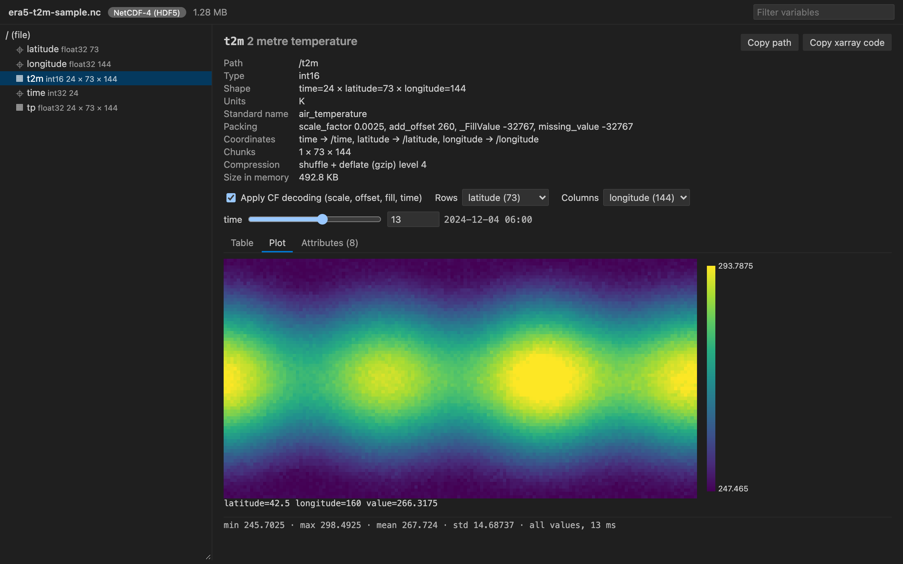

# HDF5 NetCDF Explorer

Open `.nc`, `.nc4`, `.h5` and `.hdf5` files in VS Code and see the variables, their CF metadata, the values and a plot, without writing a line of Python.

  

- Made for NetCDF and climate data. Dimension names, coordinates, `scale_factor`, `add_offset`, `_FillValue` and CF time units are applied for you, so you see 263.75 K on 2024-12-04 06:00, not `1500` at index 13. The noleap, 360_day and all_leap calendars work too.
- Big files stay fast. The file is read slice by slice in a background thread. In our test a 37 GB array opens, shows a page and draws a sampled heatmap in about one second, and a slow read is stopped after 20 s instead of freezing the editor.
- One viewer for HDF5, NetCDF-4 and NetCDF-3. Groups, attributes, compound tables, strings, chunking and compression filters are all shown. Nothing leaves your machine.

## Quick start

1. Install the extension.
2. Click a `.nc` or `.h5` file in the Explorer. Pick a variable on the left.

## What you can do

- Browse the group tree with a filter box. Coordinates, plain datasets, external links and NetCDF dimensions have their own icons.
- Read the file overview (format, dimensions, global attributes and a table of all variables with units and long names), much like `ncdump -h`.
- See type, shape with dimension names, chunk shape, compression (shuffle, deflate level, LZF, szip and others by name), size in memory and the full attribute list. Internal HDF5 and NetCDF attributes are hidden behind a checkbox.
- Pick any two dimensions as rows and columns. Sliders fix the others and show the decoded coordinate value next to the index.
- Page through values 100 rows by 30 columns at a time, with coordinate values as row and column headers.
- Plot 1D data as a line and 2D slices as a heatmap with a colour bar and hover readout. Arrays larger than 512 x 512 are sampled with a stride.
- See min, max, mean, std and the number of fill, NaN and Inf values for the slice on screen.
- Copy the path, or copy xarray or h5py code that loads the same slice.
- Turn CF decoding off to see the raw stored numbers.
- The view reloads when the file changes on disk, which helps while a model run is writing output.

## Supported files

| Format | How it is read |
|---|---|
| NetCDF-4 and NetCDF-4 classic (`.nc`, `.nc4`) | h5wasm (HDF5 2.0 compiled to WebAssembly) |
| HDF5 (`.h5`, `.hdf5`, `.he5`, `.hdf`, `.nxs`, `.h5ad`) | h5wasm |
| NetCDF-3 classic and 64-bit offset (`.nc`, `.cdf`) | netcdfjs parses the header, values are read by byte offset |

The format is detected from the first bytes of the file, not from the extension. HDF4, NASA CDF and NetCDF CDF-5 files get a clear message instead of an error.

## Settings

| Setting | Default | Meaning |
|---|---|---|
| `hdf5NetcdfExplorer.maxReadValues` | 1000000 | Largest number of values one read may return |
| `hdf5NetcdfExplorer.maxFileSizeMB` | 0 | Refuse files above this size, 0 means no limit |
| `hdf5NetcdfExplorer.readTimeoutSeconds` | 20 | Stop a read that takes longer and restart the reader |

## Privacy and safety

The extension makes no network calls and has no telemetry. It never runs code from a file. Values go to the view as plain JSON and are drawn as text or canvas pixels, under a strict Content Security Policy with no remote scripts.

## Known limits

- Files must be on this computer. Remote and virtual file systems are not supported yet.
- HDF5 filters that are not built into h5wasm (Blosc, Zstd, bitshuffle and other plugins) show the filter name and a read error.
- Zarr is not supported yet.
- The standard calendar uses the proleptic Gregorian calendar for dates before 1582.

## Credits

HDF5 reading uses [h5wasm](https://github.com/usnistgov/h5wasm) by the National Institute of Standards and Technology, which bundles the HDF5 library by The HDF Group. NetCDF-3 headers are parsed with [netcdfjs](https://github.com/cheminfo/netcdfjs) (MIT). See `THIRD-PARTY-NOTICES.txt`.

## License

MIT
